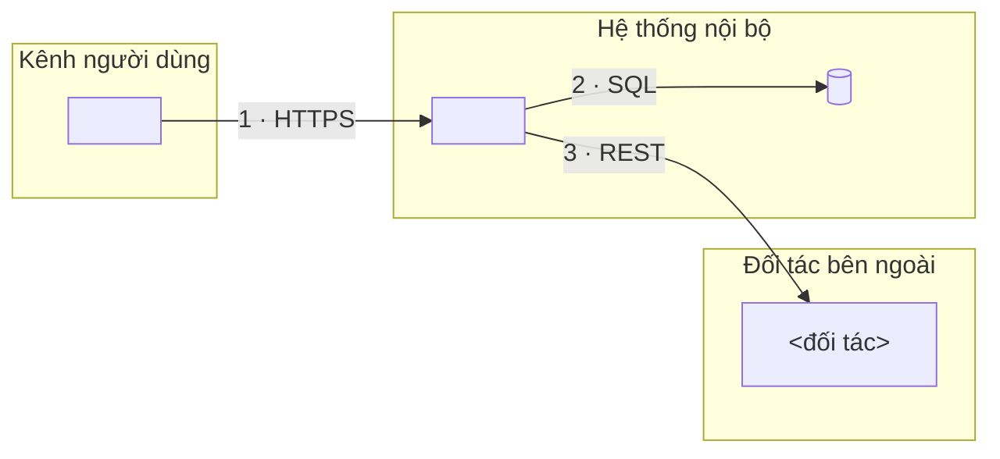
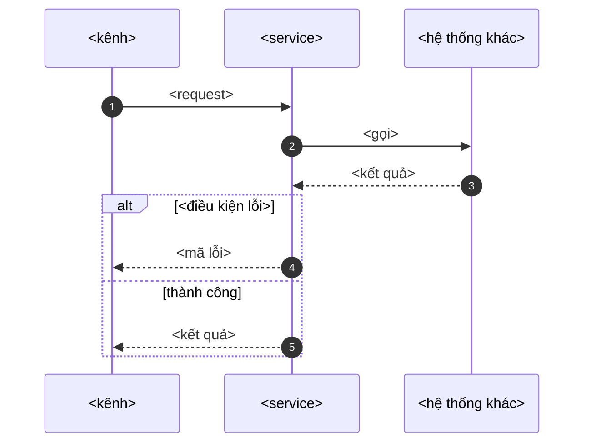
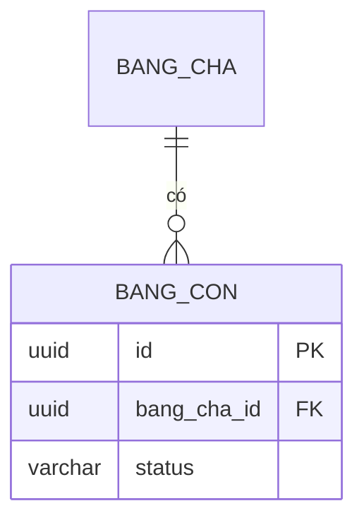

# SRS – <Tên hệ thống / tính năng>

<!-- hướng dẫn: giữ nguyên tên và thứ tự các mục. Mục không liên quan ghi "Không áp dụng — <lý do>", không xoá heading. Xoá mọi comment "hướng dẫn" khi xuất file; giữ comment "nguồn". -->

## Thông tin tài liệu

| Mục | Nội dung |
|---|---|
| Tên hệ thống / tính năng | |
| Mã dự án | <Ticket JIRA> |
| BRD | <Link BRD liên quan> |
| Người soạn | |
| Người review | |
| Trạng thái | Nháp |

## Lịch sử thay đổi

| Phiên bản | Ngày | Người sửa | Nội dung thay đổi |
|---|---|---|---|
| 0.1 | dd/mm/yyyy | | Bản nháp đầu |

## Mục đích

<!-- hướng dẫn: 1-3 câu: tài liệu đặc tả tính năng gì, cho ai, trên kênh nào. -->

## Hệ thống liên quan

| Hệ thống | Vai trò | Phương thức kết nối | Đầu mối |
|---|---|---|---|
| | | | |

<!-- nguồn: -->

## System flow

<!-- hướng dẫn: mọi hệ thống trong hình phải có trong bảng "Hệ thống liên quan" và ngược lại. Nhãn mũi tên = giao thức thật trong code/config. -->



<!-- nguồn: -->

## Sequence diagram

<!-- hướng dẫn: luồng chính đánh số, kèm các nhánh lỗi có thật trong code (alt/else). -->



<!-- nguồn: -->

## Database design

### ERD



<!-- nguồn: -->

### Index

| Bảng | Index | Cột | Phục vụ |
|---|---|---|---|
| | | | |

### DB Table

<!-- hướng dẫn: chép DDL từ file migration, đủ mọi bảng tính năng tạo hoặc sửa. Bảng bị sửa thì ghi câu ALTER thật. -->

```sql
```

<!-- nguồn: -->

## Đặc tả API

Swagger: <link hoặc đường dẫn file trong repo>

| Method | Path | Mục đích | Thay đổi |
|---|---|---|---|
| | | | Mới / Sửa |

<!-- nguồn: -->

## Log, giám sát, cảnh báo

- **Ghi những logs nào:**
- **Cần build dashboard giám sát nào:**
- **Ngưỡng cảnh báo:**

<!-- nguồn: -->

## References

- <Link Mermaid, PlantUML, draw.io, db diagram liên quan>
- <Đường dẫn file chính trong repo>

## Phụ lục

<!-- hướng dẫn: chỉ giữ tiểu mục nào có bằng chứng; không có tiểu mục nào thì bỏ cả mục Phụ lục. -->

### Quy tắc nghiệp vụ

| Quy tắc | Giá trị | Nơi kiểm tra |
|---|---|---|
| | | |

### Trạng thái


### Mã lỗi

| Mã | HTTP | Ý nghĩa | Khi nào |
|---|---|---|---|
| | | | |

<!-- nguồn: -->
